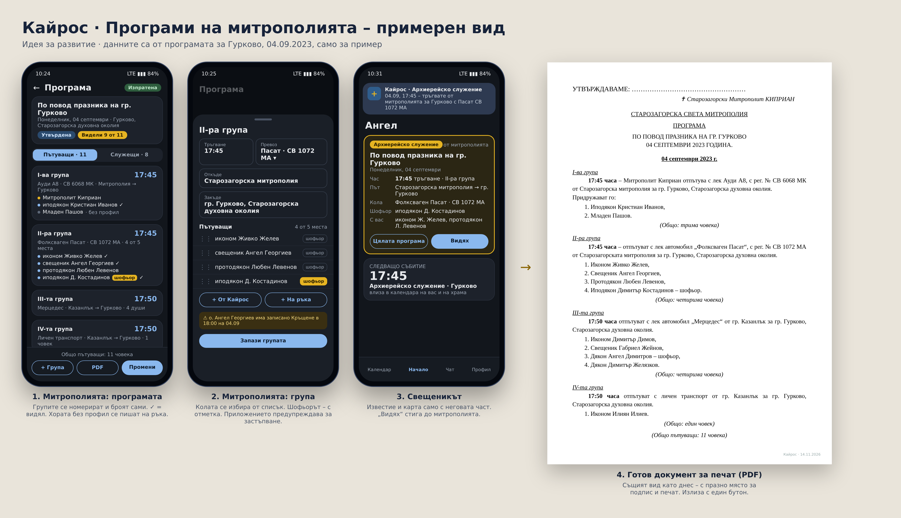

# Кайрос – план за развитие

Идеи, обсъдени с Димитър, които още **не се правят**. Не влизат в никоя версия,
докато той не каже.

---

## 1. Програми на митрополията (пътуващи за архиерейски служения)

*Записано: 14.11.2026. Чака разговор с митрополита.*

### Как е днес
Митрополията пише на ръка програма за всяко архиерейско служение (пример:
„Програма по повод празника на гр. Гурково, 04 септември 2023 г.“) и я праща
по Viber или на хартия. Документът е утвърден с подпис и печат от митрополита.

Структура на документа:
- **Горе:** „УТВЪРЖДАВАМЕ: + Старозагорски Митрополит Киприан“ (подпис и печат),
  „СТАРОЗАГОРСКА СВЕТА МИТРОПОЛИЯ“, „ПРОГРАМА по повод …“, дата.
- **Ден:** заглавие с датата (може да са няколко дни).
- **Групи I-ва, II-ра, III-та…**, всяка с:
  - час на тръгване;
  - превоз: лек автомобил с марка и рег. № („Ауди А8, СВ 6068 МК“), само марка
    („Мерцедес“) или „личен транспорт“;
  - откъде → закъде („от Старозагорска митрополия за гр. Гурково, Старозагорска
    духовна околия“);
  - номериран списък: сан + име; един е отбелязан „шофьор“;
  - „(Общо: … човека)“.
- Групата на митрополита: „Митрополит Киприан отпътува с … Придружават го: …“.
- **Накрая:** „(Общо пътуващи … човека)“.
- Отделно може да има „Списък на служещите“.
- В списъците има и хора без профил: иподякони, дякони, протодякони, миряни.

### Какво да прави Кайрос
1. **Профил „Митрополия“** – нова роля над храмовете. Вижда свещениците от
   всички храмове (без каса и чат, освен ако не се реши друго).
2. **„Програма“** – заглавие, една или няколко дати, място.
3. **Групи**, които се номерират сами (I-ва, II-ра…): час, откъде, закъде, превоз.
   - **Списък с коли** – въвеждат се веднъж (марка, рег. №, места) и после се избират.
   - Шофьор – отметка при един човек; проверка за свободни места; предупреждение,
     ако човек е в две групи.
4. **Хора** – от приложението (получават известие) или написани на ръка (без профил).
   Санове: да се добавят иподякон, дякон, протодякон (не само свещенически).
5. **Сам брои** – „Общо: …“ за група и „Общо пътуващи“.
6. **„Списък на служещите“** – втори раздел в същата програма.
7. **PDF в същия вид като днешния документ** – с празно място „УТВЪРЖДАВАМЕ“ за
   подпис и печат. Канцеларията само печата.
8. **Ход:** чернова → утвърдена (печат на PDF) → изпратена (известия).
9. **Всеки с профил** получава известие и карта с „Видях“ само със своята част:
   „04.09, 17:45 – тръгвате от митрополията за Гурково с Фолксваген Пасат
   СВ 1072 МА. Шофьор: иподякон Д. Костадинов.“ Шофьорът вижда кого вози.
   Митрополията вижда кой е видял.
10. Денят влиза в календара на свещеника и на храма му; предупреждение при
    записана треба или почивка.
11. При промяна – известие само до засегнатите.
12. „Копирай от миналогодишната“ – празниците се повтарят.

### Отговори (Димитър, 14.11.2026 – 6 г. опит в митрополията; подлежат на редакция)

**Роли и права**
- Програмите ги съставя **главно секретарят**. Утвърждава **митрополитът**, в негово
  отсъствие – **заместникът**.
- **Всеки в митрополията има профил** – вкл. счетоводител и ревизори.
- **Митрополитът е вторият по права след създателя:** от своя профил дава и маха
  правомощия на всеки профил (кой какво може), одобрява/отказва събития и отпуски,
  адресирани до него. **Не вижда** касите на храмовете, личните съобщения и
  кореспонденцията между служителите – правата му са административни.
- **Бъдеща разработка – дълъг отпуск:** свещеник → председател → препраща до
  владиката → одобрен от митрополита се вижда отличително (златно) и влиза в архива.

**Програмите**
- Броят варира: от 2–3 до ~15 на месец.
- Има и **програми с преспиване** (няколко дни).
- Списъци в програмата: **пътуващи**, **служещи**, **певци**, **поканени на обяд**
  (в обяда могат да се добавят и още хора).
- Кой какво служи (Евангелие, проскомидия) – **не** се пише.

**Пътуване**
- Коли – **служебни и лични**. Служебните се въвеждат веднъж; личните се въвеждат
  в поле и **приложението ги помни** (падащо меню).
- Има **шофьори извън клира**.
- Свещеник може сам да предложи: „пътувам с моята кола и мога да взема още N“ – като опция.

**Хора и санове**
- Санове: иподякон, дякон, протодякон, свещеник, иконом, протойерей, архимандрит,
  епископ; останалите – **без сан**.
- **Митрополит** – да се добави, но след като профилът на митрополита го заеме,
  изчезва като избор за другите.
- Миряни – получават ли известие: **още не е ясно**.

**Известяване и отговор**
- Свещеникът: **„Видях“** или **„Не мога“ със ЗАДЪЛЖИТЕЛНА причина**.
- „Не мога“ чака одобрение; **докато не е одобрено, човекът остава в списъка**.
- Одобренията отиват **и до митрополита, и до секретаря** (митрополитът рядко е в приложението).
- Известие до председателя на храма, че свещеникът отсъства – **като възможност, ще се пита**.
- При утвърден списък: **известие веднага, вечерта преди и сутринта**.

**Документ (PDF)**
- Засега – **като днешния**.
- Присъстващите **без автомобил** се помнят в падащо меню и отиват **най-долу** в
  документа като участващи в богослужението.
- **Отделен раздел „Поканени на обяд“**.
- Архив на програмите – **когато приложението е на по-голям сървър**.

**Поверителност**
- Програмата се вижда от **всички участващи**.
- Опция **„Не показвай“** – тогава се вижда само от опълномощените от митрополита.

### Допълнителни отговори (14.11.2026)
1. Миряните в списъка – **без известие засега**; който иска, може сам да изтегли приложението.
2. Председателят на храма **научава**, когато свещеникът му отсъства заради програма.
3. За „Не мога“ **е достатъчно одобрение от секретаря**. При отказ свещеникът
   **задължително получава известие, което трябва да потвърди** (карта с „ОК“).
4. Правата на митрополита: той ще иска максимален контрол, но **ограничаваме го
   колкото е възможно** – приложението е помощник за свещениците, **не средство
   за контрол**.

### Принцип за правата на митрополията (предложение)
**Може:**
- програми: съставя, утвърждава, праща, скрива („Не показвай“);
- одобрява/отказва неща, **изпратени до него** (програми, „Не мога“, бъдещ дълъг отпуск);
- раздава права **на профилите в митрополията** (секретар, заместник,
  счетоводител, ревизори);
- **всичко свързано с назначаване** (решение 14.11.2026): назначава председател на
  храм, назначава свещеник в храм, премества свещеник от един храм в друг,
  освобождава от храм; касиер – и председателят, и митрополитът (решение 14.11.2026). Свещеникът и
  председателят получават известие и карта с „ОК“ („Указ/назначение от
  митрополията“), всичко влиза в дневника;
- вижда списъка на храмовете и свещениците с ролите им и контактите, които те
  сами са дали;
- обявления до всички или до храм.

**Не може:**
- касата, склада и справките на храмовете (освен ако в бъдеще храмът сам не
  изпрати отчет);
- чата и личните съобщения;
- личния календар на свещеника (вижда само събитията от своите програми);
- кога свещеникът е влизал, дневника на действията, „Какво вижда“ – това остава
  само за създателя (за поддръжка);
- да спира или трие профили.

**Прозрачност:** всеки свещеник вижда в профила си какво вижда митрополията за
него (кратък текст, както при личните данни).

### Примерен вид

### След разговора
- Примерни екрани (редактор на програма, карта при свещеника) и примерен PDF –
  като допълнителна част към презентацията.

---

## 1а. Счетоводство на митрополията

*Записано: 14.11.2026. Подробностите – когато започнем.*

### Как е днес
Митрополията има **няколко отделни каси**:
- **Каса на митрополията** – приходи от свещи, ценни книжа и др.;
- **Каса ЕЦМ** (епархийски църковни монополи) – приходи и разходи от и за
  църковни магазини, манастири и т.н.;
- евентуално други.

Митрополията **не издава фактури и касови бележки** – работи с общоприетите
образци на **приходен и разходен касов ордер**. Води приходни и разходни книги.

### Идея – без да се променя структурата на приложението
- Митрополията е единица от вид „митрополия“ със **същата основа като храм**, но
  с **няколко каси**. Всяка каса: своя приходна и разходна книга, свои видове
  приходи/разходи, свое приключване на месец, свои справки. Храмовете остават с
  една каса – за тях нищо не се променя.
- **Ключ „Счетоводство“** – достъп до касите на митрополията (записи, книги,
  документи, справки). Може повече от един човек. Ревизорите – ключ „само за гледане“.
- **Приходен и разходен касов ордер** – номерирани поред за всяка каса, попълнени
  от записа (дата, от кого/на кого, основание, сума с цифри и словом), PDF точно
  по образеца с места за подписи; всеки ордер влиза автоматично в книгата.
- **Продажба на свещи на храм** – митрополията избира храм, видове и количества
  (цените се попълват сами).
- **Решение (14.11.2026): НЯМА връзка между книгите и касите на митрополията и
  тези на храмовете** – всеки въвежда своите сам. Храмът получава **само
  известие** – напр. „Митрополията ви изписа 20 кг свещи по 0,50 €“ – без нищо да се
  записва при него; колкото да знае какво да въведе.
  **Предпазна проверка:** когато касиерът на храма въвежда доставка на свещи,
  приложението сравнява с последното известие от митрополията и при голяма
  разлика пита: „Митрополията ви изписа 20 кг, а въвеждате 200 кг – сигурни ли
  сте?“. Не пречи на записа, само пита – хваща грешки като 200 вместо 20.
- **Книги и справки** – по каса и по месец, за печат; обобщения по вид и по храм.
- **Склад на митрополията** (голям склад за свещи) – отговорникът/касиерът
  изписва количество → **излиза прозорец** с полетата от образеца на БПЦ (за кой
  храм, кой получава и т.н.) → готов документ (PDF) за печат и подпис. Едно
  изписване = един документ; от него: наличността в склада на митрополията
  намалява, а сумата влиза в касата на митрополията. Касата и книгите на храма
  не се пипат – храмът си въвежда сам. Справки: колко свещи е
  взел всеки храм по месеци.

### Нужно от Димитър, когато започнем
- Образците на приходния и разходния касов ордер (снимка или файл).
- Примерна страница от приходната и разходната книга.
- Образецът на БПЦ за документа при продажба на свещи на храм.

### Отворени въпроси
1. ~~Какъв документ съпровожда продажбата на свещи на храм?~~ – **образец на БПЦ**;
   Димитър ще го предостави, когато започнем.
2. Колко каси има общо и кой вижда всяка?
3. Има ли записи, които митрополитът одобрява преди да влязат в книгата?
4а. ~~Кога се плаща?~~ – **обикновено веднага**, в брой или по банков път; в редки
   случаи – по-късно. В прозореца: „Плащане: в брой / по банка / по-късно“. В брой
   и по банка влизат веднага в съответната книга на касата; „по-късно“ отива в
   справка „Неплатени“ по храмове и при плащане се отбелязва с един бутон.
4. С каква счетоводна програма работят – може ли Кайрос да изнася данни за нея?
   *(Ще се уточни със счетоводството.)*

---

## 1б. Епархии, наместничества и длъжности (уточнено 15.11.2026)

**Структура:** Епархия → Архиерейско наместничество → Храм → Свещеници.
Епархийският център (седалището, напр. Стара Загора) няма наместник – в
падащото меню е отделен ред „Стара Загора (епархийски център)“ наравно с
наместничествата; за него отговаря протосингелът.

**Епархиите на БПЦ** – 13 в България: Софийска, Пловдивска, Варненска и
Великопреславска, Великотърновска, Видинска, Врачанска, Доростолска,
Ловчанска, Неврокопска, Плевенска, Русенска, Сливенска, Старозагорска;
2 в чужбина: Западно- и Средноевропейска, Американска, Канадска и
Австралийска. Плюс служебна епархия **„Тест“** – в нея отиват всички
сегашни профили и храмове; не се показва в менюто, само създателят слага
хора в нея. Наместничествата на всяка епархия се попълват от официалния
сайт на митрополията и се проверяват; създателят и митрополията могат да
ги поправят.

**Регистрация:**
- Човек – избира епархия от падащо меню. Смяна само от създателя
  („Смени епархия“ в таблото; показва кои храмове ще напусне и иска
  потвърждение). Пазач в базата: не може да се влезе в храм от чужда епархия.
- Храм – председателят избира епархия (своята) и наместничество (или
  „епархийски център“).

**Длъжности:**
| Длъжност | Обхват | Назначава |
|---|---|---|
| Митрополит | цялата епархия | създателят оторизира акаунта (никой не може сам да си направи митрополитски профил) |
| Викарен епископ | цялата епархия; правата – за обсъждане | митрополитът |
| Протосингел | епархийският център (като наместник) | митрополитът |
| Архиерейски наместник | своето наместничество | митрополитът |

Наместникът/протосингелът остава и обикновен свещеник в своя храм.

**Изглед на митрополита:** дърво – епархийски център и наместничествата,
в тях храмовете, в храмовете свещениците (име, сан, длъжност, телефон).
Наместникът вижда същото само за своето наместничество.

**Търсачка за всички:** едно поле по име, сан, длъжност, храм, населено
място, наместничество; резултати групирани (хора · храмове ·
наместничества). Всеки търси в това, което има право да вижда –
митрополията в епархията, наместникът в наместничеството, свещениците –
колегите си (за обсъждане: само в своята епархия ли).

**Функции по епархия (16.11.2026):** в таблото на създателя за всяка
епархия – списък с функции и ключ до всяка (каса, склад, чат, програми,
окръжни, отпуски с утвърждаване, версия за компютър…). Изключеното изчезва за
всички храмове в епархията и е пазено и в сървъра; данните не се трият.
Едно приложение за всички – то само проверява какво е включено. Позволява нова
функция първо в една епархия, после за другите. (Сега същото го има на ниво
храм – каса, склад, чат.)

**Отворени въпроси:** правата на викарния епископ; какво точно прави
наместникът (назначения, обявления, програми?).

## 1г. Митрополитски профил – решения от 15.11.2026

**Роли:** митрополит, викарен епископ (правата – за обсъждане), протосингел
(епархийският център), архиерейски наместник (своята околия), **секретар –
задължително, точно един**. Секретарят подготвя, владиката утвърждава.
Митрополитски профил се разрешава само от създателя.

**Какво вижда митрополията за всеки храм:**
- свещениците (име, сан, длъжност, **телефон**), адрес, Булстат;
- от календара на храма – **нищо** (решено 18.11.2026: нито службите, нито
  дежурствата – вътрешният живот на храма не е за контрол отгоре); само
  адрес, Булстат и път до храма;
- **отпуските** (кой и кога), но **не** почивките.
- **Касата и складът – САМО председателят и касиерът на храма.** Никой извън
  храма: нито митрополията, нито наместникът, нито създателят.

**Наместникът** вижда същото като митрополията за своята околия; може да
праща обявления до своите храмове и да предава нагоре.

**Календар на владиката:** записват и владиката, и секретарят (срещи,
посещения, служби); бутон „Споделен със секретаря“; записи „само за мен“,
които секретарят не вижда; утвърдените програми влизат сами. По-късно –
еднопосочно копиране в Google Calendar.

**Почивки и отпуски – два отделни вида:**
- почивка – вътрешна за храма, решава председателят, никой извън храма не я
  вижда (както сега);
- отпуска – официална: председателят одобрява, после утвърждава горното ниво
  (наместник/протосингел или митрополията – да се уточни); молбата на
  председателя отива направо на второто ниво; до появата на митрополитския
  профил – само председателят, с бележка „утвърждаване – предстои“;
- свещеник в отпуска не може да бъде назначен за служба;
- председателят може да превърне стара почивка в отпуска;
- **молба за отпуск по образец** – готова за печат и подпис;
- годишен лимит на дните – за обсъждане (приложението може да брои дните).

**Документи за печат:** всичко, което се изпраща, има печатна версия A4 в
утвърдения вид на епархията (всяка епархия – своя бланка; малките разлики
са настройки, големите – отделна бланка по снимка). Подпис и печат – винаги
на ръка, никога изображение. Списък: молба за отпуск, касови ордери, касови
книги, отчети, складова книга и ревизия, заявка към склада на митрополията,
график на дежурствата, програма за архиерейско служение, заповед за
назначение, окръжно, обобщение на отпуските. Най-добре – оригиналните
Word/PDF файлове от канцеларията; иначе – по скан.

**Програми за архиерейски служения – проба (уеб, само за създателя):**
групи/коли, сан и роля от менюта, запомнени хора и коли с подсказване,
обичаен шофьор, предупреждение за повторена кола, часът се наследява от
предишната група, „Списък на служещите“ се попълва с всички със сан,
„Добави от пътуващите“ с научени отметки, документ за печат във вида на
старозагорската бланка. Паметта е само в браузъра; в истинската версия ще е
в базата (регистрираните свещеници от епархията + външни хора).
Следва: **стари програми** – всяка отпечатана програма се пази (дата, повод,
брой пътуващи); „Направи нова по тази“ копира групите, колите, хората,
часовете, списъците и забележките, а датата и поводът остават празни за
попълване; старата може и да се отпечата отново; триене и преименуване
(„Обичайното посещение с микробуса“). В истинската версия – в базата,
видими и за владиката.

**Създателят и чувствителните данни (преди тестовете в Стара Загора):**
в таблото транзакциите се виждат с дата, час, автор и вид, но **без суми и
наличности**; после достъпът се заключва и в сървъра. В презентацията –
не се изтъква; в бележките има готов отговор, ако попитат.

**Уеб версията:** в бъдеще да заприлича на уебсайт (не на приложение) –
удобна за канцеларията.

## 1д. Митрополия – ред на изграждане и идеи (16.11.2026)

**Ред:** (1) митрополитският акаунт и секретарят – сега; (2) счетоводството
на митрополията – касиер, счетоводител, ревизори; (3) шофьорите и служебните
автомобили.

**Направено (16.11):** длъжности (митрополит, секретар, протосингел,
наместник, служител с титла), изглед „Епархия“ с търсачка, митрополитски
изглед в пурпур и злато (като вътрешния вид на митрополията), меню според
длъжността, чат „Митрополия“ (администрацията – без наместниците – плюс лични
разговори), пурпурни значки за длъжностите. Секретарят засега е цивилен (без
храм) – добавя се по потребителско име.

**Програми за архиерейски служения – решения (16.11.2026):**
- Съставя секретарят; владиката утвърждава в приложението с бутон.
  Хартията с „УТВЪРЖДАВАМЕ“, подпис и печат остава (не всички ще са в
  Кайрос). *Да се попита в митрополията.*
- Известията тръгват след утвърждаване; при промяна после – само до
  засегнатите. *Да се попита дали промяната иска ново утвърждаване.*
- Регистрираните участници виждат само своята част (група, час, кола,
  шофьор, откъде, служи ли, обяд, път до храма); нерегистрираните (хор,
  видеооператор, гости) – само в документа.
- Участник може да откаже – със задължителна причина; секретарят получава
  известие и може да приеме отказа или да го отхвърли.
- Председателят на храма домакин получава известие (дата, брой пътуващи,
  обяд за колко души); в календара на храма влиза архиерейска служба.
- Мястото – храм от списъка на епархията (адресът и навигацията идват сами)
  или свободен текст, ако го няма.
- Гости на обяда – вписва ги секретарят; председателят също може да добави,
  с известие и потвърждение поне от секретаря. *За обсъждане.*

**„Повикай“ – владиката вика служител в кабинета (решено 16.11.2026):**
- Бутон в профила и голям бутон на началния екран на митрополита. Само
  митрополитът може да вика.
- Списък със служителите на митрополията (секретар, протосингел, служители –
  без наместниците); може един или няколко души, по желание кратка бележка.
- Повиканият получава известие със собствен, по-настойчив звук (звънец).
  Ако не отговори до 2–3 минути, известието звъни повторно.
- Отговор с едно докосване: „Идвам“ или „Не мога“ – отговорът стига до
  владиката.
- „Не безпокойте“ на Android спира звука, освен ако човекът не разреши
  изключение за Кайрос – приложението ще го подкани.

**Направено (16.11, следобед):** „Повикай“ (звънец, повторно след 2 мин,
„Идвам“/„Не мога“, подкана за „Не безпокойте“); календар на владиката (пише и
секретарят, „само за мен“); храм от епархията – адрес, Булстат, навигация и
дежурствата; начален екран на секретаря; заключените функции.

**Заключени функции (решено 16.11.2026):** всичко, което е решено, но още
не е направено, се показва в профилите на митрополита и секретаря като
бутон с катинар и „Предстои“; при докосване – кратко описание какво ще
прави. Така владиката и секретарят виждат целия замисъл от първия ден.
Митрополит: Програми, Окръжни, Отпуски, Документи за печат, Google
Calendar, Счетоводство, Автопарк. Секретар: Програми, Окръжни, Отпуски,
Документи за печат, Автопарк.

**Функции на служителите (по-късно):** вместо една титла – отметки за
функции (шофьор, ревизор, счетоводител, деловодител…); човек може да има
няколко (напр. шофьор и ревизор). Всяка функция добавя своя раздел; титлата
се изписва от функциите. Всеки има в Кайрос точно това, което върши.

**Служебни автомобили (по-късно):** марка, модел, номер, титулярен шофьор
(един или повече – напр. единият кара мултивана и аудито, другият буса);
документи със срок – гражданска отговорност, каско, винетка, технически
преглед, данък (за обсъждане: ремонти, гуми, масло, пробег); напомняния 30 и
7 дни преди изтичане до шофьора и отговорника; снимка на полицата/талона;
в програмите колата се избира от автопарка и шофьорът се добавя сам;
шофьорът вижда своите коли, секретарят и владиката – всички.

## 1е. Лични съобщения между храмовете (решено 16.11.2026)

- Чатът се дели на „Храм“ (общият чат на текущия храм) и „Лични“.
- Между двама души има **един** личен разговор, независимо от храма;
  старите лични съобщения от общите им храмове се сливат в него по дата.
- Лично може да се пише на всеки от **своята епархия** – „Нов разговор“ с
  търсене по име. Първото съобщение излиза направо в чата (без покана).
- „Блокирай“ в личния разговор – тихо: блокираният не разбира, пише си,
  но съобщенията му не стигат до вас.
- Под името се вижда храмът на човека (напр. „Иерей Тодор · Св. Николай,
  Казанлък“).
- Поредност: след като календарът на владиката стане като календара в
  храмовете. Едно по едно, с тест след всяко.

## Чака пускане (с работата по митрополията, от понеделник)

- Митрополията не вижда дежурствата – само адрес, Булстат и път до храма.
- В митрополията пишем само какво могат, никога какво не могат.
- (Кодът вече е в main и е пуснат само на създателя.)

## 1з. Тест в реална среда – събота, 21.11.2026

Преди това задължително: пускане на всички (чистене на пробните храмове,
камбанката); таблото на създателя без суми и заключено в сървъра; всичко
отметнато в таблицата „Кайрос – за тестване“.

## 1ж. Кайрос за компютър – по макета (решено 16.11.2026)

Едно по едно, с пускане на сайта и проба след всяко:
1. Каса по макета: пътечка, заглавие с месеца, Печат / Excel / Нов запис,
   четири плочки, филтри, таблицата на целия екран (всички записи за
   месеца, подреждане с клик). Печат – каквото е на екрана (месец +
   филтри), лист A4. Excel – истински .xlsx.
2. Епархия – доизпипване по макета (пътечка, заглавие, Списък за печат,
   филтри Храм/Длъжност).
3. Календар – голяма месечна мрежа; в клетката „час + вид + свещеник“,
   при много – „+2 още“. Същото и за календара на владиката.
0. (първо) Прозорците, които сега излизат отдолу (запис в касата, ново
   събитие и т.н.), на компютър да се отварят като прозорец в средата на
   екрана.
4. Почивки, дежурства, склад в същия стил; „Свещеници“ в менюто под
   „Храм“ като таблица (име, сан, роля, телефон).

## 1в. Окръжни от митрополията (обсъдено 15.11.2026)

Замества разпращането по Viber. В профила на секретаря.

- **Съдържание:** заглавие, кратък текст и прикачени файлове от всякакъв
  вид. Снимки и PDF се отварят направо в приложението; Word, Excel и др. се
  свалят и отварят с програмата на устройството.
- **Получатели:** всички храмове, избрани околии (наместничества), избрани
  храмове или комбинация. При всяко окръжно секретарят избира „всички
  свещеници“ или „само председателите“.
- **Номер и дата** – „Окръжно № … / дата“, номерацията е автоматична.
- **Известие** до получателите; „Прочетох“ от всеки; секретарят вижда кой е
  прочел и праща напомняне само на непрочелите.
- **Архив** с търсене по номер, дата и дума.
- **Печат:** всичко става за печат – снимките и PDF от приложението, другите
  файлове от програмата им; самото окръжно и като лист A4 (митрополията
  отгоре, прикачените снимки – всяка на нова страница). Снимките се смаляват
  внимателно – остри за A4, но десетина пъти по-малки от оригинала.
- **Утвърждаване:** засега секретарят праща направо (обикновено по устна
  заповед); ще се попита в митрополията – може да е настройка „окръжните
  минават през владиката: да/не“.
- **Наместникът** може да препрати окръжното до своята околия, с бележка;
  вижда се, че е препратено от него.

## 2. Други отложени идеи

- **Адрес и Булстат в профила на храма** (15.11.2026): нови полета – точен
  адрес (населено място, улица, №) и Булстат; попълва ги председателят, вижда
  ги всеки член. Под адреса – два бутона „Google Maps“ и „Waze“, които с едно
  натискане отварят навигацията до храма (по адреса, по желание и с точка от
  картата за селата без улици). Подготовка за профила на митрополията: при
  програма за служение избраният храм вече носи адреса и бутоните за път;
  Булстатът ще трябва и за документите по образец и счетоводството.

- **Смарт часовник:** бутони направо в известието („Одобри“ за почивка,
  „Отговори“ в чата), по-кратък текст, различна вибрация по важност.
- **Профил на митрополията** – общ поглед, отчети от всички храмове (след
  разговора с митрополита).
- **Уеб версия за компютър** (14.11.2026): от същия код (Flutter web), същият
  сървър и права. Подредба за голям екран (меню отстрани, таблици, календар на
  месеца, каса като книга, програма с групите една до друга); известия в
  браузъра; печат/PDF директно. Основно за секретаря, канцеларията, касиерите,
  председателите, счетоводителя и ревизорите. Да се прави заедно с профила на
  митрополията или веднага след него. Нужен е адрес (домейн) и хостване.
- **Widget за началния екран (Android)** (14.11.2026): малък „Следващо“, среден
  „Днес и утре“ + дежурен, голям „Месец“ с цветните точки. Докосване отваря деня.
  Обновяване: на 15 мин. (минимумът на Android), веднага при известие и в момента,
  в който събитие започне/свърши. Настройка „Скрий имената“. Huawei/Xiaomi –
  „Стартиране на приложения“ ръчно. iPhone – отделно, по-късно.
- **Ревизори (много по-късен етап – сложно):** ревизират всички обекти на
  епархията – храмове, манастири, магазини, складове. Идеи: видове обекти върху
  основата на храма; профил „само за гледане“ (каса, склад, документи, забележки,
  протокол от ревизия); никога чат/лични съобщения; дневник на прегледаното.
  Нерешено: постоянен достъп или ревизия с назначение и срок / известие до
  отговорника.
- **Ревизори (много по-късен етап – сложно):** ревизират всички храмове и обекти на
  епархията (храмове, манастири, магазини, складове). Идея: видове „обекти“ върху
  основата на храма; ревизорът вижда само за гледане каса, склад, документи,
  забележки и протокол от ревизия; никога чат и лични неща. Отворено: постоянен
  достъп или ревизия с назначение и срок (или известие при отваряне на обект).
- **iPhone версия.**
- **Нощно резервно копие на базата; махане на тестовите настройки** преди
  истинските свещеници.
