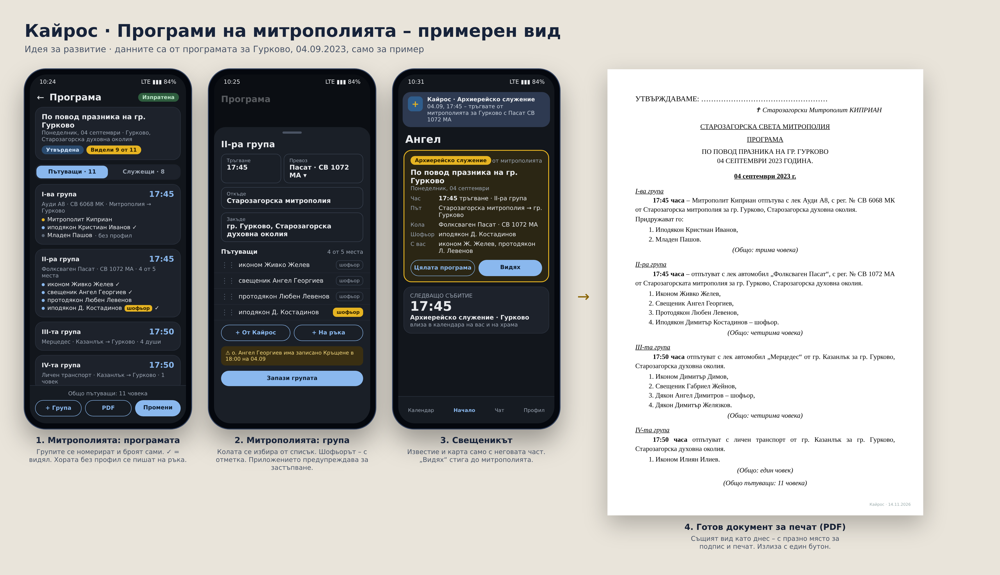

# Кайрос – план за развитие

Идеи, обсъдени с Димитър, които още **не се правят**. Не влизат в никоя версия,
докато той не каже.

---

## 1. Програми на митрополията (пътуващи за архиерейски служения)

*Записано: 14.11.2026. Чака разговор с митрополита.*

### Как е днес
Митрополията пише на ръка програма за всяко архиерейско служение (пример:
„Програма по повод празника на гр. Гурково, 04 септември 2023 г.“) и я праща
по Viber или на хартия. Документът е утвърден с подпис и печат от митрополита.

Структура на документа:
- **Горе:** „УТВЪРЖДАВАМЕ: + Старозагорски Митрополит Киприан“ (подпис и печат),
  „СТАРОЗАГОРСКА СВЕТА МИТРОПОЛИЯ“, „ПРОГРАМА по повод …“, дата.
- **Ден:** заглавие с датата (може да са няколко дни).
- **Групи I-ва, II-ра, III-та…**, всяка с:
  - час на тръгване;
  - превоз: лек автомобил с марка и рег. № („Ауди А8, СВ 6068 МК“), само марка
    („Мерцедес“) или „личен транспорт“;
  - откъде → закъде („от Старозагорска митрополия за гр. Гурково, Старозагорска
    духовна околия“);
  - номериран списък: сан + име; един е отбелязан „шофьор“;
  - „(Общо: … човека)“.
- Групата на митрополита: „Митрополит Киприан отпътува с … Придружават го: …“.
- **Накрая:** „(Общо пътуващи … човека)“.
- Отделно може да има „Списък на служещите“.
- В списъците има и хора без профил: иподякони, дякони, протодякони, миряни.

### Какво да прави Кайрос
1. **Профил „Митрополия“** – нова роля над храмовете. Вижда свещениците от
   всички храмове (без каса и чат, освен ако не се реши друго).
2. **„Програма“** – заглавие, една или няколко дати, място.
3. **Групи**, които се номерират сами (I-ва, II-ра…): час, откъде, закъде, превоз.
   - **Списък с коли** – въвеждат се веднъж (марка, рег. №, места) и после се избират.
   - Шофьор – отметка при един човек; проверка за свободни места; предупреждение,
     ако човек е в две групи.
4. **Хора** – от приложението (получават известие) или написани на ръка (без профил).
   Санове: да се добавят иподякон, дякон, протодякон (не само свещенически).
5. **Сам брои** – „Общо: …“ за група и „Общо пътуващи“.
6. **„Списък на служещите“** – втори раздел в същата програма.
7. **PDF в същия вид като днешния документ** – с празно място „УТВЪРЖДАВАМЕ“ за
   подпис и печат. Канцеларията само печата.
8. **Ход:** чернова → утвърдена (печат на PDF) → изпратена (известия).
9. **Всеки с профил** получава известие и карта с „Видях“ само със своята част:
   „04.09, 17:45 – тръгвате от митрополията за Гурково с Фолксваген Пасат
   СВ 1072 МА. Шофьор: иподякон Д. Костадинов.“ Шофьорът вижда кого вози.
   Митрополията вижда кой е видял.
10. Денят влиза в календара на свещеника и на храма му; предупреждение при
    записана треба или почивка.
11. При промяна – известие само до засегнатите.
12. „Копирай от миналогодишната“ – празниците се повтарят.

### Отговори (Димитър, 14.11.2026 – 6 г. опит в митрополията; подлежат на редакция)

**Роли и права**
- Програмите ги съставя **главно секретарят**. Утвърждава **митрополитът**, в негово
  отсъствие – **заместникът**.
- **Всеки в митрополията има профил** – вкл. счетоводител и ревизори.
- **Митрополитът е вторият по права след създателя:** от своя профил дава и маха
  правомощия на всеки профил (кой какво може), одобрява/отказва събития и отпуски,
  адресирани до него. **Не вижда** касите на храмовете, личните съобщения и
  кореспонденцията между служителите – правата му са административни.
- **Бъдеща разработка – дълъг отпуск:** свещеник → председател → препраща до
  владиката → одобрен от митрополита се вижда отличително (златно) и влиза в архива.

**Програмите**
- Броят варира: от 2–3 до ~15 на месец.
- Има и **програми с преспиване** (няколко дни).
- Списъци в програмата: **пътуващи**, **служещи**, **певци**, **поканени на обяд**
  (в обяда могат да се добавят и още хора).
- Кой какво служи (Евангелие, проскомидия) – **не** се пише.

**Пътуване**
- Коли – **служебни и лични**. Служебните се въвеждат веднъж; личните се въвеждат
  в поле и **приложението ги помни** (падащо меню).
- Има **шофьори извън клира**.
- Свещеник може сам да предложи: „пътувам с моята кола и мога да взема още N“ – като опция.

**Хора и санове**
- Санове: иподякон, дякон, протодякон, свещеник, иконом, протойерей, архимандрит,
  епископ; останалите – **без сан**.
- **Митрополит** – да се добави, но след като профилът на митрополита го заеме,
  изчезва като избор за другите.
- Миряни – получават ли известие: **още не е ясно**.

**Известяване и отговор**
- Свещеникът: **„Видях“** или **„Не мога“ със ЗАДЪЛЖИТЕЛНА причина**.
- „Не мога“ чака одобрение; **докато не е одобрено, човекът остава в списъка**.
- Одобренията отиват **и до митрополита, и до секретаря** (митрополитът рядко е в приложението).
- Известие до председателя на храма, че свещеникът отсъства – **като възможност, ще се пита**.
- При утвърден списък: **известие веднага, вечерта преди и сутринта**.

**Документ (PDF)**
- Засега – **като днешния**.
- Присъстващите **без автомобил** се помнят в падащо меню и отиват **най-долу** в
  документа като участващи в богослужението.
- **Отделен раздел „Поканени на обяд“**.
- Архив на програмите – **когато приложението е на по-голям сървър**.

**Поверителност**
- Програмата се вижда от **всички участващи**.
- Опция **„Не показвай“** – тогава се вижда само от опълномощените от митрополита.

### Допълнителни отговори (14.11.2026)
1. Миряните в списъка – **без известие засега**; който иска, може сам да изтегли приложението.
2. Председателят на храма **научава**, когато свещеникът му отсъства заради програма.
3. За „Не мога“ **е достатъчно одобрение от секретаря**. При отказ свещеникът
   **задължително получава известие, което трябва да потвърди** (карта с „ОК“).
4. Правата на митрополита: той ще иска максимален контрол, но **ограничаваме го
   колкото е възможно** – приложението е помощник за свещениците, **не средство
   за контрол**.

### Принцип за правата на митрополията (предложение)
**Може:**
- програми: съставя, утвърждава, праща, скрива („Не показвай“);
- одобрява/отказва неща, **изпратени до него** (програми, „Не мога“, бъдещ дълъг отпуск);
- раздава права **на профилите в митрополията** (секретар, заместник,
  счетоводител, ревизори);
- **всичко свързано с назначаване** (решение 14.11.2026): назначава председател на
  храм, назначава свещеник в храм, премества свещеник от един храм в друг,
  освобождава от храм; касиер – и председателят, и митрополитът (решение 14.11.2026). Свещеникът и
  председателят получават известие и карта с „ОК“ („Указ/назначение от
  митрополията“), всичко влиза в дневника;
- вижда списъка на храмовете и свещениците с ролите им и контактите, които те
  сами са дали;
- обявления до всички или до храм.

**Не може:**
- касата, склада и справките на храмовете (освен ако в бъдеще храмът сам не
  изпрати отчет);
- чата и личните съобщения;
- личния календар на свещеника (вижда само събитията от своите програми);
- кога свещеникът е влизал, дневника на действията, „Какво вижда“ – това остава
  само за създателя (за поддръжка);
- да спира или трие профили.

**Прозрачност:** всеки свещеник вижда в профила си какво вижда митрополията за
него (кратък текст, както при личните данни).

### Примерен вид

### След разговора
- Примерни екрани (редактор на програма, карта при свещеника) и примерен PDF –
  като допълнителна част към презентацията.

---

## 2. Други отложени идеи

- **Смарт часовник:** бутони направо в известието („Одобри“ за почивка,
  „Отговори“ в чата), по-кратък текст, различна вибрация по важност.
- **Профил на митрополията** – общ поглед, отчети от всички храмове (след
  разговора с митрополита).
- **Уеб версия за компютър** (14.11.2026): от същия код (Flutter web), същият
  сървър и права. Подредба за голям екран (меню отстрани, таблици, календар на
  месеца, каса като книга, програма с групите една до друга); известия в
  браузъра; печат/PDF директно. Основно за секретаря, канцеларията, касиерите,
  председателите, счетоводителя и ревизорите. Да се прави заедно с профила на
  митрополията или веднага след него. Нужен е адрес (домейн) и хостване.
- **Widget за началния екран (Android)** (14.11.2026): малък „Следващо“, среден
  „Днес и утре“ + дежурен, голям „Месец“ с цветните точки. Докосване отваря деня.
  Обновяване: на 15 мин. (минимумът на Android), веднага при известие и в момента,
  в който събитие започне/свърши. Настройка „Скрий имената“. Huawei/Xiaomi –
  „Стартиране на приложения“ ръчно. iPhone – отделно, по-късно.
- **iPhone версия.**
- **Нощно резервно копие на базата; махане на тестовите настройки** преди
  истинските свещеници.
